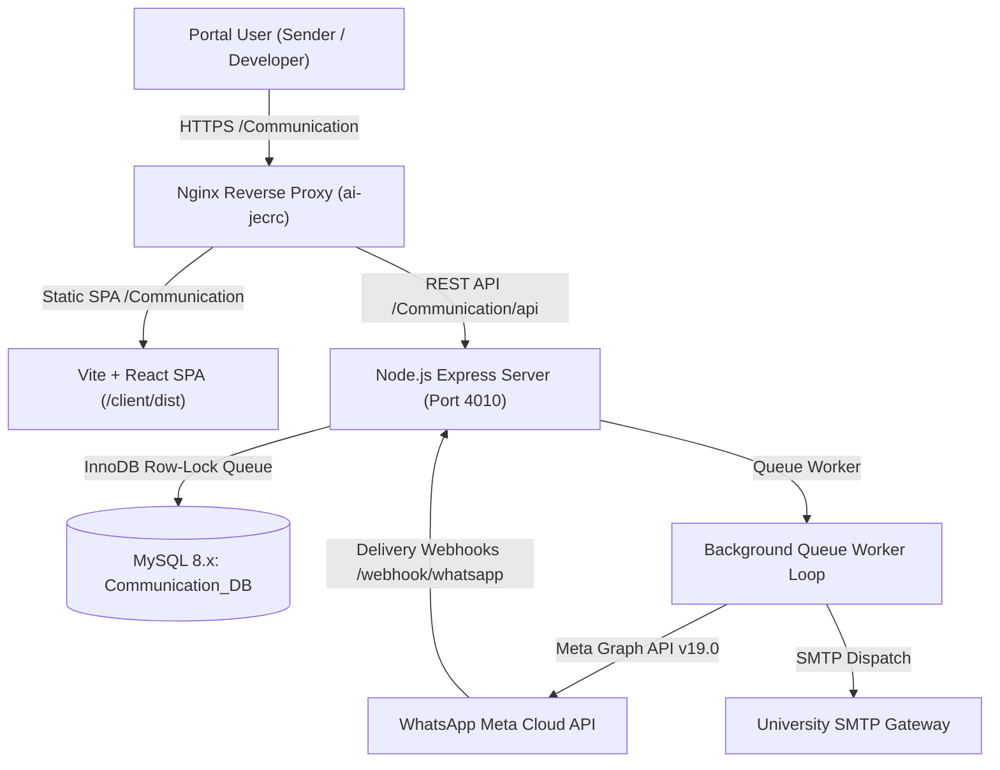
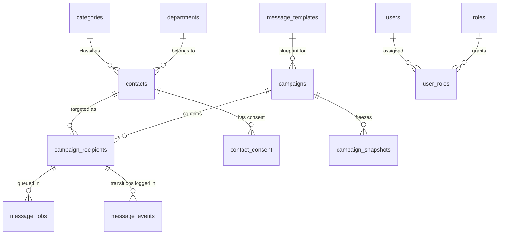

# JECRC University Communication Portal — Engineering Handover & Operations Manual

> **Document Version**: 2.0.0  
> **Last Updated**: November 2026  
> **Target Production Machine**: `172.16.2.48` (`ai.jecrcuniversity.edu.in`)  
> **Primary Maintainer / Developer Role**: System Developer & Forensics Admin  

---

## 1. Executive Summary & Purpose

The **JECRC University Enterprise Communication Portal** is an institutional-grade, dual-channel broadcast and forensics platform engineered for large-scale communications (100,000 to 500,000+ recipients). It serves two primary broadcast channels:
1. **WhatsApp Meta Cloud API**: Official transactional, utility, and administrative notice broadcasts with dynamic template variable interpolation, header documents (PDFs), images, and real-time delivery receipts (`SENT` $\rightarrow$ `DELIVERED` $\rightarrow$ `READ`).
2. **Bulk Email Dispatcher**: Multi-batch university announcements with real-time SMTP dispatching, formatting, and recipient progress tracking.

### Core Architectural Principles
- **Zero Redis / Zero Docker**: Operates natively on Ubuntu Linux with native MySQL 8.x InnoDB row-level locking (`SKIP LOCKED`) for the durable queue engine.
- **Institutional Privacy**: Recipient phone numbers are encrypted with **AES-256-CBC** at rest and tokenized with **SHA-256** deterministic hashes. Plain phone numbers are strictly redacted and never exposed in client tables, logs, error dumps, or URLs.
- **Subpath Coexistence**: Deployed cleanly under `/Communication/` alongside other services (JU Bot, HR Portal, SCM, Calling System) without cross-process interference.



---

## 2. Production Environment Specification

All production operations run on the following host:

| Parameter | Production Value |
| :--- | :--- |
| **Server IP (Internal LAN)** | `172.16.2.48` |
| **Public FQDN** | `https://ai.jecrcuniversity.edu.in/Communication/` |
| **Operating System** | Ubuntu 22.04.5 LTS (Linux kernel 6.8.0-138-generic x86_64) |
| **Application Directory** | `/var/www/communication-portal` |
| **Git Repository** | `https://github.com/pachoritarun/emailer-and-whatspp.git` (Branch: `main`) |
| **Backend API Port** | `4010` (Internal binding `0.0.0.0:4010`, proxied by Nginx) |
| **Process Manager** | **PM2** (Process Name: `communication-api`, PM2 ID: `20`) |
| **Database Instance** | MySQL 8.x Community Server on `127.0.0.1:3306` |
| **Production Database** | `Communication_DB` |
| **Web Server / Proxy** | Nginx (`/etc/nginx/sites-available/ai-jecrc`) |
| **WABA Account ID** | `1321780173260474` |
| **Phone Number ID** | `1133153459884742` |

---

## 3. Directory & Codebase Structure

```
e:\Whatsapp_Dashboard/  (Local)  /var/www/communication-portal/ (Production)
├── client/                          # Frontend Application (React 18 + Vite + TypeScript)
│   ├── dist/                        # Production build artifacts (served by Nginx)
│   ├── public/                      # Static assets & public PDF circulars
│   │   ├── Nursing_CBT_Batch1.pdf   # Direct download circular for Batch 1 (8:30 AM)
│   │   └── Nursing_CBT_Batch2.pdf   # Direct download circular for Batch 2 (10:30 AM)
│   ├── src/
│   │   ├── api/client.ts            # Centralized API client with automatic subpath base URL
│   │   ├── components/              # UI Components
│   │   │   ├── FirstTimeSetupModal  # Mandatory initial credential reset dialog
│   │   │   ├── SendNoticeModal.tsx  # Notice Broadcast Wizard (Variables, Media, Groups)
│   │   │   ├── Sidebar.tsx          # Brand-compliant left navigation
│   │   │   └── TopBar.tsx           # Page header, user profile, and sign-out controls
│   │   ├── views/                   # Full-page views
│   │   │   ├── ContactsView.tsx     # Recipient directory, Excel upload & re-categorization
│   │   │   ├── DashboardView.tsx    # Live metric KPI counters and dispatch status
│   │   │   ├── DeveloperConsoleView # System diagnostics, queue depth & forensic timeline
│   │   │   ├── EmailerView.tsx      # Native bulk emailer dispatcher
│   │   │   ├── LoginView.tsx        # Branded university credential authentication
│   │   │   ├── NoticeHistoryView    # Campaign receipt drilldown & delivery states
│   │   │   ├── SenderActivityView   # Forensic audit log of sender actions
│   │   │   └── TemplateStudioView   # Live WhatsApp template creator & Meta sync
│   │   └── vite.config.ts           # Configured with base: '/Communication/'
├── server/                          # Backend API Engine (Node.js + Express + TypeScript)
│   ├── dist/                        # Compiled JavaScript output (`npm run build`)
│   ├── public/                      # Public media endpoint files (`/api/media/:filename`)
│   ├── scripts/
│   │   ├── setup-db.mjs             # Idempotent database schema & seed initializer
│   │   └── seed-dummy-contacts.mjs  # Benchmark testing script with 10 test numbers
│   ├── src/
│   │   ├── config/index.ts          # Central environment configuration & defaults
│   │   ├── db/pool.ts               # MySQL connection pool & in-memory dev fallback
│   │   ├── queue/
│   │   │   ├── mysql-queue.ts       # Atomic InnoDB row-level locking queue (`SKIP LOCKED`)
│   │   │   └── worker.ts            # Queue worker consumer & WhatsApp dispatcher loop
│   │   ├── routes/                  # Express REST API endpoints
│   │   │   ├── auth.ts              # Login, token validation & password updates
│   │   │   ├── campaigns.ts         # Broadcast wizard, snapshot creation, recipient queues
│   │   │   ├── contacts.ts          # Excel ingestion, category detection, masked listings
│   │   │   ├── emailer.ts           # Bulk email batch processor
│   │   │   ├── templates.ts         # Meta Cloud API template studio & local caching
│   │   │   └── webhooks.ts          # Meta incoming delivery status webhook ingestion
│   │   └── services/
│   │       ├── auth-service.ts      # PBKDF2 password hashing & active session management
│   │       ├── crypto.ts            # AES-256-CBC encryption, SHA-256 hashes, phone clean
│   │       ├── logger.ts            # Forensic structured JSON logger with phone redaction
│   │       ├── message-lifecycle.ts # 10-stage state machine & immutable event logging
│   │       └── whatsapp-provider.ts # Meta Cloud API v19.0 HTTP client
├── database/
│   ├── schema.sql                   # Complete 20-table relational MySQL schema
│   └── seed.sql                     # Initial roles, departments, categories & system settings
├── deploy/
│   ├── deploy.sh                    # Automated shell deployment script
│   └── nginx/university-portal.conf # Hardened Nginx configuration blueprint
```

---

## 4. Database Schema & Data Models

The system of record is **`Communication_DB`**. It contains 20 relational tables designed for zero-leakage forensics and high-throughput locking:



### Critical Tables
1. **`contacts`**:
   - `id VARCHAR(36) PRIMARY KEY`: UUID.
   - `external_identifier VARCHAR(100) UNIQUE`: Institutional ID (Roll No, Application ID, or auto-generated `UNI-...`).
   - `phone_hash VARCHAR(64) UNIQUE`: SHA-256 hash used for deduplication without storing plaintext.
   - `phone_encrypted VARBINARY(255)`: AES-256-CBC encrypted payload with prepended IV.
   - `category_id`: Foreign key to `categories` (`CAT-STU`, `CAT-FAC`, `CAT-STF`, `CAT-CAN`, `CAT-ALM`).
   - `department_id`: Foreign key to `departments`.
2. **`message_jobs` (The MySQL Queue Engine)**:
   - Replaces Redis/BullMQ.
   - Fields: `status` (`QUEUED`, `LOCKED`, `COMPLETED`, `DEAD_LETTER`), `locked_by_worker`, `locked_at`, `available_at`, `priority`.
   - Consumer claims jobs with:
     ```sql
     SELECT id, job_uuid, campaign_id, campaign_recipient_id, retry_count
     FROM message_jobs
     WHERE status = 'QUEUED' AND available_at <= NOW(3)
     ORDER BY priority DESC, id ASC
     LIMIT 1
     FOR UPDATE SKIP LOCKED;
     ```
3. **`campaign_snapshots`**:
   - Immutable record of audience filters, template text, variables, and system configuration frozen at the exact second a notice is launched.
4. **`message_events`**:
   - Append-only forensic trace of every transition (`QUEUED` $\rightarrow$ `PROCESSING` $\rightarrow$ `SUBMITTED_TO_PROVIDER` $\rightarrow$ `DELIVERED` $\rightarrow$ `READ` or `FAILED`).

---

## 5. Security & Cryptography Standards

### 1. Zero Plaintext Phone Exposure
- Plain phone numbers **NEVER** enter MySQL in plaintext.
- Phone numbers are encrypted in [`server/src/services/crypto.ts`](file:///e:/Whatsapp_Dashboard/server/src/services/crypto.ts):
  $$\text{Payload} = \text{IV}_{16} \parallel \text{AES-256-CBC}(\text{Key}, \text{IV}, \text{Phone})$$
- When displayed in the UI, numbers are masked to only reveal the operator and terminal digits (e.g., `+91 93093 •••44`).

### 2. User Authentication & Password Hashing
- Algorithm: **PBKDF2** with SHA-512, 100,000 iterations, 64-byte key length, and unique cryptographically random 32-byte salts.
- Verification uses `crypto.timingSafeEqual` to eliminate timing-attack vulnerabilities.
- Default Roles:
  - **`DEVELOPER`**: Full administrative authority, forensics console, audit logs, template submission, sender activity oversight.
  - **`SENDER`**: Operational broadcast sender, contact manager, notice history viewer, email dispatcher.
- Initial Default Accounts (Must be changed upon first login via the security gate):
  - Developer: `Developer` (Initial seed: `Pass46979@devjecrcu`)
  - Sender: `Sender` (Initial seed: `Pass4sender@70789`)

---

## 6. Excel Spreadsheet Ingestion Engine

Located in [`server/src/routes/contacts.ts`](file:///e:/Whatsapp_Dashboard/server/src/routes/contacts.ts), the upload processor supports `.xlsx`, `.xls`, and `.csv` files.

### Intelligent Column Mapping Matrix
The parser inspects row keys case-insensitively and maps fields dynamically:

| Target Property | Detected Column Headers (Regex) | Fallback / Default |
| :--- | :--- | :--- |
| **Mobile Phone** | `mobile`, `mobile no.`, `phone`, `contact`, `cell`, `whatsapp`, `wa`, `ph` | Regex scanning for 10-digit mobile number `[6-9]\d{9}` inside cell content |
| **Institutional ID** | `application id`, `app id`, `regno`, `reg_no`, `roll`, `enroll`, `idno`, `empid` | `UNI-<timestamp>-<row_index>` |
| **Full Name** | `candidate name`, `student name`, `full name`, `emp name`, `name` | `Candidate (<ID>)` or `Recipient <last4>` |
| **Department / Post**| `department`, `dept`, `branch`, `course`, `program`, `position`, `designation` | `General Department` or selected department |
| **Target Category** | User dropdown selection in UI takes precedence: `STUDENT`, `FACULTY`, `STAFF`, `CANDIDATE`, `ALUMNI` | Column `Category` / `Role` or smart column inspection |

### Key Ingestion Rules
1. **Handling Files Without Names**: If an applicant list only contains IDs and phone numbers, names automatically default to `Candidate (<Application ID>)`.
2. **Multiple Numbers on Same Application ID**: If multiple phone numbers share one Application ID, the engine automatically appends suffixes (`-2`, `-3`) to preserve every number without database key overwrites.
3. **Phone Number Sanitization**: Automatically strips Excel `.0` float artifacts, leading `0`, punctuation, and adds standard `91` country code.

---

## 7. Dynamic Variable Interpolation in Broadcasts

In [`server/src/queue/worker.ts`](file:///e:/Whatsapp_Dashboard/server/src/queue/worker.ts), when a campaign dispatches notices, variables are dynamically resolved on a per-recipient basis:

| Placeholder Tag | Dynamic Resolution Source |
| :--- | :--- |
| **`{{1}}`** or `{{name}}` | Recipient's real Full Name from contact record (e.g., `Trilok Sharma`). Fallback: `Candidate` / `Student`. |
| **`{{2}}`** or `{{id}}` | Recipient's exact Institutional ID (e.g., `JMCHRC-APP/2026-000405`). |
| **`{{3}}`, `{{4}}`, etc.** | Custom static values specified in the broadcast wizard (e.g., Reporting Time, Gate No). |
| **Header Document** | Direct PDF download link passed in header components (e.g., `/api/media/Nursing_CBT_Batch1.pdf`). |

---

## 8. Deployment & Operational Runbooks

### 1. Routine Application Update (Pull & Restart)

Run these commands on the production server `172.16.2.48`:

```bash
# 1. Navigate to application folder
cd /var/www/communication-portal

# 2. Pull latest code from GitHub
git pull origin main

# 3. Build Server & Client
cd server && npm run build
cd ../client && npm run build

# 4. Restart PM2 Process
pm2 restart communication-api
```

### 2. Updating Meta Cloud API Credentials

When the WhatsApp Access Token expires or needs renewal:
1. Open the server environment configuration:
   ```bash
   nano /var/www/communication-portal/server/.env
   ```
2. Update the token variable:
   ```env
   WHATSAPP_TOKEN="<new_meta_system_user_permanent_token>"
   ```
3. Restart the API:
   ```bash
   pm2 restart communication-api --update-env
   ```

### 3. Nginx Configuration Blueprint

The server block inside `/etc/nginx/sites-available/ai-jecrc`:

```nginx
# ==============================================================================
# JECRC UNIVERSITY COMMUNICATION PORTAL (/Communication/)
# ==============================================================================

# 1. API Reverse Proxy
location /Communication/api/ {
    proxy_pass http://127.0.0.1:4010/api/;
    proxy_http_version 1.1;
    proxy_set_header Host $host;
    proxy_set_header X-Real-IP $remote_addr;
    proxy_set_header X-Forwarded-For $proxy_add_x_forwarded_for;
    proxy_set_header X-Forwarded-Proto $scheme;
    proxy_read_timeout 120s;
    client_max_body_size 50M;
}

# 2. Meta WhatsApp Webhook Ingress
location /Communication/webhook/ {
    proxy_pass http://127.0.0.1:4010/webhook/;
    proxy_http_version 1.1;
    proxy_set_header Host $host;
    proxy_set_header X-Real-IP $remote_addr;
    proxy_set_header X-Forwarded-For $proxy_add_x_forwarded_for;
    proxy_buffering off;
}

# 3. Frontend Single Page Application (SPA)
location /Communication/ {
    alias /var/www/communication-portal/client/dist/;
    index index.html;
    try_files $uri $uri/ /Communication/index.html;
}
```

> [!IMPORTANT]
> Always verify syntax before reloading Nginx:
> ```bash
> sudo nginx -t && sudo systemctl reload nginx
> ```

---

## 9. Monitoring, Logs & Forensics

### Live Monitoring Commands
```bash
# Check PM2 process status
pm2 list

# Stream live server logs
pm2 logs communication-api

# View last 100 log lines
pm2 logs communication-api --lines 100 --nostream

# Inspect database queue depth directly
mysql -u root -pMysqlserver469 Communication_DB -e "
  SELECT status, COUNT(*) as job_count FROM message_jobs GROUP BY status;
"

# Check active campaigns and delivery counts
mysql -u root -pMysqlserver469 Communication_DB -e "
  SELECT code, name, targeted_count, delivered_count, status, created_at 
  FROM campaigns ORDER BY created_at DESC LIMIT 5;
"
```

### Forensic Reconciliation & Dead Letter Queue (DLQ)
- If a background worker terminates unexpectedly (`kill -9` or OOM), jobs in `LOCKED` state for $> 5$ minutes are automatically recovered and returned to `QUEUED`.
- If a message fails transiently (Meta rate limit `130429` or 5xx), it retries up to **3 times** with exponential backoff ($5\text{s}, 25\text{s}, 125\text{s}$).
- Messages failing non-retryable errors (e.g. `131026: Message undeliverable`) transition to `DEAD_LETTER` and can be inspected in the **Developer Console**.

---

## 10. Handover Checklist for Future Engineers

- [ ] Repository remote is set to `https://github.com/pachoritarun/emailer-and-whatspp.git`.
- [ ] Production directory `/var/www/communication-portal` has user write permissions.
- [ ] Database credentials in `server/.env` connect to `Communication_DB`.
- [ ] Meta WABA ID `1321780173260474` and Phone ID `1133153459884742` are configured.
- [ ] `pm2 save` has been executed so processes resurrect after server reboot.
- [ ] New templates created in WhatsApp Manager must match the template name in the portal (lowercase, underscores only).
- [ ] All PDF media circulars must be placed in `/server/public/` and served via `/api/media/<filename>.pdf`.

